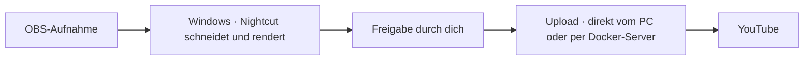

# VODWerft

**Aus langen OBS-Aufnahmen werden Folgen und Highlights. Windows schneidet, auf Wunsch übernimmt dein Docker-Server den YouTube-Upload.**

**[English version → README.md](README.md)** · das englische User Guide ist unten verlinkt

  
  
  
  
  

💬 **Community & Support:** [VOD-Werft-Bereich auf Discord beitreten](https://discord.paddyzockt.fun) (Rolle VOD-Werft in #rollen-wahl auswählen)

> **0.1.0-beta.6 · Beta zum Ausprobieren.** Der Windows-Installer ist da und läuft auf Windows 11 mit NVIDIA-Grafikkarte. Er ist noch **nicht digital signiert**, Windows zeigt deshalb eine Warnung (siehe unten). Auf frischen Rechnern ist er noch wenig getestet. Fehler bitte als Issue melden.

## So funktioniert der Ablauf

Der Windows-PC bearbeitet das Material. Der Upload läuft entweder **direkt vom PC** (einfach, kein Server nötig) oder über einen **Docker-Server** (Dauerbetrieb, der Gaming-PC kann danach aus).

## Was VODWerft kann

- Ordnerüberwachung: neue Aufnahmen werden erkannt und der Reihe nach verarbeitet.
- Schnitt in Folgen oder eine ganze Mission als ein Video, mit Titel, Beschreibung und Vorschaubild.
- Aufnahmeprofile pro Spiel (Bibliothek mit Beispielen oder eigener Name), Folgenlänge und Veröffentlichungstage einstellbar.
- Tray-Symbol mit Status, Dashboard und Einrichtungsassistent.
- Optional: Schnittplan von Hand prüfen, Übergänge an Schnitten, laufenden Auftrag stoppen, Restzeit pro Schritt.
- **Sicher voreingestellt:** Nichts wird hochgeladen, bevor du es freigibst. Jede Folge wartet auf deine Freigabe.
- **Manuell hochladen (ohne Google-Projekt):** VODWerft bereitet Video, Titel, Beschreibung und Vorschaubild vor und öffnet YouTube Studio. Du ziehst die Datei selbst hinein.
- Automatischer Upload zu YouTube mit Zeitplan, direkt vom PC oder über den Docker-Server (braucht ein eigenes Google-Projekt).

## Voraussetzungen

- Windows-PC (getestet mit Windows 11) mit **NVIDIA-Grafikkarte, 16 GB Grafikspeicher** empfohlen, rund 30 GB freier Speicher.
- Internetverbindung: Die lokalen KI-Modelle sind rund **25 GB** groß, der Download dauert je nach Leitung 30 Minuten bis mehrere Stunden.
- Ein YouTube-Kanal. Mit **„Von Hand hochladen“** brauchst du sonst nichts. Nur für den **automatischen Upload** brauchst du ein eigenes Google-Cloud-Projekt mit YouTube-Zugang. Das ist der aufwendigste Teil, er ist im [Handbuch](docs/HANDBUCH.de.md) Schritt für Schritt beschrieben.
- *Optional:* ein Docker-Host (Linux, Unraid, NAS) für den Server-Modus.
- OBS mit getrennten Tonspuren für die Aufnahme.

uv, ffmpeg und Ollama installiert der Installer auf Wunsch selbst. Es wird nichts ohne Haken installiert.

## Installieren

1. [**VODWerft-Setup.exe** herunterladen](https://github.com/PaddyZockt/VODWerft/releases/latest).
2. **Windows warnt:** Edge oder SmartScreen zeigen „Windows hat den PC geschützt“ oder „wird nicht häufig heruntergeladen“. Das ist bei einer Beta normal, der Installer ist noch nicht signiert. Klicke auf **Weitere Informationen → Trotzdem ausführen** (in Edge: Download **Beibehalten → Trotzdem beibehalten**).
3. Den Fragen im Installer folgen. Eine Schrittliste und ein Fortschrittsbalken zeigen, wo er steht.
4. Am Ende öffnet sich der Einrichtungsassistent.

Das **[Handbuch](docs/HANDBUCH.de.md)** (Englisch: **[User guide](docs/USER-GUIDE.en.md)**) erklärt Installation, Einrichtung, YouTube-Anmeldung, Deinstallation und häufige Probleme. Datenschutz: [DATENSCHUTZ.de.md](docs/DATENSCHUTZ.de.md).

## Deinstallieren

Einstellungen → Apps → Installierte Apps → VODWerft → Deinstallieren. Optional entfernst du uv, ffmpeg, Ollama und die VODWerft-Modelle gleich mit (standardmäßig bleibt alles). Deine Daten bleiben unter `%LOCALAPPDATA%\VODWerft`.

## Fehler melden

Ein [Issue anlegen](https://github.com/PaddyZockt/VODWerft/issues/new) mit Windows-Version, Grafikkarte und einer kurzen Beschreibung. Issues sind öffentlich: bitte **keine** Zugangsdaten, Tokens oder persönliche Pfade posten. Die Log-Datei `%TEMP%\vodwerft-setup.log` hilft bei Installationsfehlern, schau sie vorher durch.

## Mitwirkende und Lizenz

- **PaddyZockt** · Projektgründer und Maintainer
- **OpenAI Codex** und **Claude (Anthropic)** · KI-Entwicklungsassistenz
- Schnitt und Analyse nutzen [Nightcut](https://github.com/Nilson89/nightcut) von Nilson89 (MIT-Lizenz), siehe [THIRD-PARTY.md](docs/THIRD-PARTY.md).

Lizenz: MIT, siehe [LICENSE](LICENSE).
