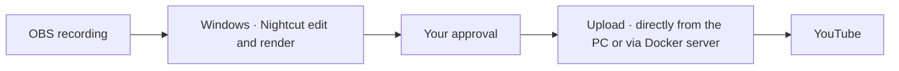

# VODWerft

**Turn long OBS recordings into episodes and highlights. Windows does the cutting; an optional Docker server handles the YouTube upload.**

**[Deutsche Version (German) → README.de.md](README.de.md)** · the German manual is linked below

  
  
  
  
  

💬 **Community & Support:** [Join the VOD-Werft area on Discord](https://discord.paddyzockt.fun) (pick the VOD-Werft role in #rollen-wahl)

> **0.1.0-beta.5 · Beta to try out.** The Windows installer is available and runs on Windows 11 with an NVIDIA GPU. It is **not code-signed yet**, so Windows shows a warning (see below). It has had little testing on fresh machines. Please report problems as an issue.

## How it works

The Windows PC does the media work. Uploading runs either **directly from the PC** (simple, no server needed) or on a **Docker server** (round-the-clock, the gaming PC can be off afterwards).

## What it does

- Folder watching: new recordings are detected and processed in order.
- Cuts into episodes or keeps a whole mission as one video, with title, description and thumbnail.
- Recording profiles per game (library with examples or your own name); episode length and publishing weekdays are configurable.
- Tray icon with status, dashboard and setup assistant.
- **Safe defaults:** nothing is uploaded before you approve it. Every episode waits for your approval.
- **Manual upload (no Google project):** VODWerft prepares video, title, description and thumbnail and opens YouTube Studio. You drag the file in yourself.
- Automatic upload to YouTube with a schedule, directly from the PC or through the Docker server (needs your own Google project).

## Requirements

- A Windows PC (tested on Windows 11) with an **NVIDIA GPU, 16 GB VRAM** recommended, about 30 GB free disk space.
- Internet connection: the local AI models are about **25 GB**; the download takes 30 minutes to several hours.
- A YouTube channel. With **"Von Hand hochladen"** (upload by hand) you need nothing else. Only for **automatic upload** you need your own Google Cloud project with YouTube access. That is the most involved part and is described step by step in the [user guide](docs/USER-GUIDE.en.md).
- *Optional:* a Docker host (Linux, Unraid, NAS) for server mode.
- OBS with separate audio tracks for recording.

The installer can install uv, ffmpeg and Ollama for you on request. Nothing is installed without a tick.

## Install

1. [Download **VODWerft-Setup.exe**](https://github.com/PaddyZockt/VODWerft/releases/latest).
2. **Windows warns you:** Edge or SmartScreen shows "Windows protected your PC" or "not commonly downloaded". That is normal for a beta because the installer is not signed yet. Click **More info → Run anyway** (in Edge: **Keep → Keep anyway**).
3. Follow the installer questions. A step list and a progress bar show where it is.
4. At the end the setup assistant opens.

The **[user guide](docs/USER-GUIDE.en.md)** (German: **[Handbuch](docs/HANDBUCH.de.md)**) covers installation, setup, YouTube sign-in, uninstalling and common problems. German privacy notes: [DATENSCHUTZ.de.md](docs/DATENSCHUTZ.de.md).

## Uninstall

Settings → Apps → Installed apps → VODWerft → Uninstall. You can also remove uv, ffmpeg, Ollama and VODWerft's models (nothing is removed by default). Your data stays in `%LOCALAPPDATA%\VODWerft`.

## Report problems

[Open an issue](https://github.com/PaddyZockt/VODWerft/issues/new) with your Windows version, GPU and a short description. Issues are public: **do not** post credentials, tokens or personal paths. The log file `%TEMP%\vodwerft-setup.log` helps with install problems; read it through first.

## Contributors and licence

- **PaddyZockt** · founder and maintainer
- **OpenAI Codex** and **Claude (Anthropic)** · AI development assistance
- Cutting and analysis use [Nightcut](https://github.com/Nilson89/nightcut) by Nilson89 (MIT licence), see [THIRD-PARTY.md](docs/THIRD-PARTY.md).

Licence: MIT, see [LICENSE](LICENSE).
